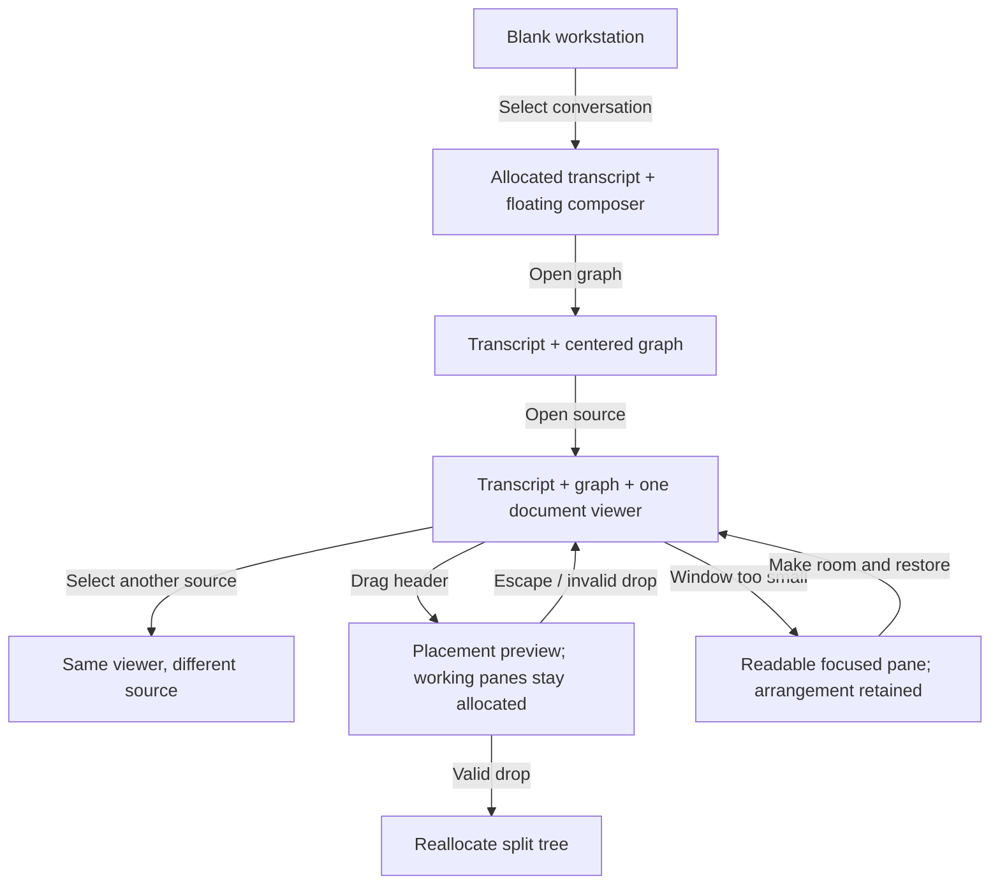

# Stage A: material and bounded-layout review

October 28, 2026. The user approved the rebuild plan, not these new visuals. This is the first review artifact under that plan. The full MVP and the file/browser feasibility gates are not complete.

## What changed

The new `workstation/` app preserves `prototype/` and its data. A fresh entry is blank, with the compact rail and floating composer. Work appears deliberately. The separate `/materials` page is a component specimen with headings and examples; it is not a product landing page.

The work layout is a tab-free split tree. Dragging a header shows a placement preview; working panes retain allocated regions until a valid drop. Shared dividers resize neighbors. Focus/restore preserves the arrangement. Invalid capacity produces an explanation instead of a floating window. Shrinking the browser can collapse navigation and focus a pane while preserving the prior arrangement.

Opening the first document alongside chat and graph gives the reader a full-height region, with chat and graph sharing the neighboring column. Later documents reuse the viewer. Browser and agent-settings panes have separate identities. Those disconnected-service panes prove allocation only, not the underlying integration.

Sources/context, project agent and goals are separate simultaneous right utilities. Each collapses and closes independently; boundaries and column width resize by pointer or keyboard. Content scrolls within bounded utility regions. A saved work-pane arrangement is local and does not copy source content.

Conversation navigation extends from the left rail. Project channel, personal chat and human-DM drafts have distinct scope labels. The channel contains explicitly labeled excerpts from the actual interview, not invented live teammates. Main and thread drafts are separate. Attachments store explicit source IDs with their draft/message. Opening a document does not retarget the composer. No message is delivered to another person or agent.

The graph uses the actual four repository sources grouped under Direction and Research. It starts with collapsed folders. Containment edges have an explicit legend; no similarity, dependency or live-access edge is fabricated. Folder actions open the explorer; document actions reuse the viewer without removing the graph. The subject remains centered, drags only slightly and springs home. There is no application zoom or physics toggle.

## Module roles and transitions

| Role | Identity/state | Open/close behavior |
| --- | --- | --- |
| Conversation | Conversation ID, main/thread draft, explicit local source attachments | Selecting another conversation replaces the transcript, preserving the resource and other drafts |
| Document | One viewer; selected source ID and per-source reading location | Another source reuses the viewer; closing the view does not delete the source |
| Graph | Subject and branch expansion are separate from layout | Exploring a folder/file keeps the graph; Full graph restores the project subject |
| Explorer | Current folder and local source search | Allocated beside other work; does not spawn another document viewer |
| Browser | Independent module type; no session service connected | Can allocate/resize/close; clearly states that navigation/login are not implemented |
| Agent settings | Local personal preferences; no executing runtime | UI visibility does not start, cancel or retire a job |
| Right utilities | Three separate utility modules | Their visibility/size does not alter source records, agent assignment or goals |

## Material direction for review

Use blue ink/accent, a restrained atmospheric background, glass on navigation/composer/utility chrome and opaque reading surfaces. Light/dark follow the OS, with explicit account-appearance overrides. DM Sans is bundled locally; icons use Lucide consistently. Focus rings, keyboard splitters and reduced-motion/transparency treatments are implemented. This is a proposed direction, not a claim that it satisfies the user's visual taste without review.

Actual review captures: [fresh entry](workstation/evidence/fresh-light.png), [working arrangement in light](workstation/evidence/work-light.png), [working arrangement in dark](workstation/evidence/work-dark.png), [light component specimen](workstation/evidence/materials-light.png) and [dark component specimen](workstation/evidence/materials-dark.png). These show implementation, not acceptance.

The component specimen includes source rows, agent readiness/approval/disconnected examples, conversation, composer, document text, node grammar and error/focus examples. Its approval/reconnect buttons are visual specimens, not live services. Loading/error states for actual source fetching are wired in the reader.

## Implementation choices for this proof

React 19.3.1, TypeScript 7.0.2, Vite 8.3.5, Dockview/Gridview 8.8.0, D3 Force 3.0.0, Lucide React 1.63.0 and DM Sans Variable 5.3.0 are pinned in the lockfile. These are proof implementation choices, not approval of a production backend or provider.

Gridview supplies nested tab-free allocations and pointer split resizing. Custom code adds placement previews, directional movement, capacity recovery and keyboard/ARIA resizing. No floating/tabbed Dockview layout or paid extension is enabled. The [licensing documentation](https://dockview.dev/docs/overview/licence/) distinguishes the free MIT core from commercial features.

`predev`/`prebuild` generate source snapshots and a SHA-256 manifest. These are build inputs with stable proof IDs, not a private/shared duplication mechanism. No application authorization boundary exists: this loopback review server is not a shareable production service.

## Verification and practical limits

All 14 browser scenarios passed after the last substantive layout change. The suite covers fresh blank entry; coexistence at 1280×800, 1440×1000, 1920×1080 and 1280×720; pane bounds/intersections; document reuse; recipient and main/thread-draft isolation; graph exploration and subject return; valid/canceled drag; keyboard and pointer resizing; utility collapse; narrow-window recovery; OS appearance; local DM behavior; attachment without unintended send; local preset restoration; and damaged local-state rejection. Production build/type checking and format checking are run separately.

Observed defects fixed during this pass: draft indicators changing accessible conversation names; thread drafts sharing main drafts; document reading position resetting on pane remount; clipped arrangement menus; hidden panes retaining keyboard-accessible elements; inability to switch a focused pane in a narrow window; source-menu buttons accidentally submitting their surrounding composer form; and the layout engine's direct movement operation using an invalid destination after an ancestor split collapsed. Movement now resolves the destination after removal and rolls back on failure. Tests establish the exercised behavior only. They do not establish visual acceptance, every possible split tree or production readiness.

Proof limitations remain explicit:

- All conversation/goals/preferences/layout data is browser-local. DM contact lookup/delivery, real identities, shared persistence, server permissions and multiplayer are absent.
- The viewer reads Markdown snapshots. It is not a DOCX/XLSX/PPTX engine or editable/shared resource service.
- The browser pane has no interactive session. No screenshot or arbitrary iframe is called a working browser.
- The project agent is disconnected. There are no executing jobs, real approvals, context maintenance, schedules, retrieval or live presence.
- One local work-pane preset is implemented. Named preset collections, per-project/personal layouts, remembered utility sizing/order/pinning and cross-device restoration are future work.
- Desktop layout has been exercised at the sizes above and narrow-window recovery at 900×650. Full mobile behavior, screen-reader audit, broad touch/pen coverage and large knowledge-base density are unproven.
- Build tooling reports a large entry bundle and ignored library `use client` directives in this client-only app. These warnings are recorded, not silently treated as production optimization complete.

## File and browser feasibility gates

| Gate | Evidence from this pass | Current outcome / next required proof |
| --- | --- | --- |
| Bounded layout | Working split-tree implementation and real browser interactions | Ready for visual/behavior review; not an acceptance claim |
| Office engine | Confirmed local headless LibreOfficeDev 26.8.0.0.alpha0 is available. No Docker/Podman executable or web Office engine is configured in this app. [ONLYOFFICE's integration documentation](https://api.onlyoffice.com/docs/docs-api/get-started/basic-concepts) describes separate web editors and deployment options. | Headless conversion is not interactive web editing. Still need a selected test engine endpoint, storage/save callbacks, real DOCX/XLSX/PPTX round trips, layout/formula/image checks and two-user editing. No engine was deployed or account purchased. |
| Interactive web browser | Rechecked [Browserless Live URL documentation](https://docs.browserless.io/baas/monitor-sessions/embedding-live-url): its interactive viewer requires a connected browser session and service configuration; viewer-link and session lifetimes differ. | No provider session/token is configured in the app. Still need actual isolated navigation/login/input, resize/reconnect/expiry and personal versus project ownership tests. No personal browsing data was imported. |

Both engine gates remain open. A service configuration decision is needed before those complete proofs; a disconnected module is not evidence they passed. This does not require the user to repeat product discovery.

## Next decision

Review the working arrangements and component/material direction. The approved plan explicitly says **“Review before expanding feature work.”** Continue full implementation only after that design review, while keeping the outstanding engine proofs visible. Then proceed to authoritative identities/canonical data and real conversations/resources, rather than decorating disconnected UI as completed collaboration.
